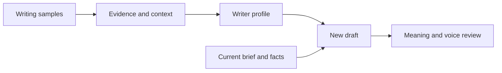

<p align="center"></p>

<p align="center">
  <strong>Evidence-backed writing voices for Codex, Claude, Gemini CLI, and other assistants.</strong><br>
  One portable skill. Separate writer profiles. Three editing modes.
</p>

<p align="center">
  <a href="docs/installation.md">Install</a> ·
  <a href="docs/usage.md">Use it</a> ·
  <a href="examples/README.md">See an example</a> ·
  <a href="docs/compatibility.md">Compatibility</a> ·
  <a href="docs/design-research.md">Design research</a>
</p>

# Match Writing Voice

**Create or update my voice profile.** Build a profile from your samples or add examples, edits, and preferences to one you already use. The profile records habits and short examples in the contexts where they fit. [Create or update a profile](docs/usage.md#create-or-update-my-voice-profile)

**Write or rewrite in my voice.** Supply notes or existing prose. The skill selects examples that serve the same purpose as the section it is writing. Humanizer review fixes stock openings, empty recaps, and formulaic transitions where they weaken the prose. Rewrites check the source facts, figures, citations, and caveats before delivery. [Write or rewrite](docs/usage.md#write-or-rewrite-in-my-voice)

## Start here

Clone this private repository with an authenticated GitHub account:

```sh
gh repo clone danielcarde/match-writing-voice
cd match-writing-voice
```

Choose one installation route per assistant. For a local, dependency-free install:

```sh
python tools/install.py --agent codex --scope user
# Or: --agent claude-code / --agent gemini-cli
```

For Claude web/desktop, download `match-writing-voice-claude.zip` from [Releases](https://github.com/danielcarde/match-writing-voice/releases), upload it through **Customize → Skills**, and enable it. For a chat without native skills, attach `match-writing-voice-portable.md` instead. [Complete setup instructions →](docs/installation.md)

Then supply your samples and ask:

```text
Use Match Writing Voice to build a profile from these samples.
Then draft a message asking to reschedule an appointment in my voice.
```

In Codex, explicitly mention `$match-writing-voice`. In a standalone Claude Code installation, use `/match-writing-voice`. Gemini CLI activates matching skills after its normal consent prompt.

## What it preserves

| Layer | Examples |
|---|---|
| Words | Vernacular, contractions, idioms, favored expressions, code-switching |
| Sentences | Fragments, coordination, interruptions, rhythm, length variation |
| Surface habits | Casing, punctuation, recurring spelling and grammar irregularities |
| Passages | Paragraph shape, openings, closings, explanation order, rhetorical habits |
| Context | Medium, audience, relationship, language, degree of formality |
| Evidence | Source spans, independent samples, counterexamples, uncertainty |

An isolated typo is weak evidence. A repeated habit still belongs in its context. The skill does not add random errors or force a favorite expression into every paragraph.

## Rewrite a draft

```text
Use Match Writing Voice to rewrite this document in my saved voice.
Keep the original structure, facts, examples, quotations, and citations.
```

Structure is preserved by default. Say “light edits only,” “fix obvious grammar slips,” or “you can reorganize” to adjust the edit. “Show me what changed” requests a comparison. “Check for hidden characters” requests an inspection of copy and paste artifacts. [Usage guide](docs/usage.md)

## How it works



The skill supplies a method. A writer profile supplies individual habits. Optional Python tools measure text, verify evidence, retrieve context-matched examples, and flag narrow draft problems. Candidate selection enforces completed meaning and voice reviews before writing a chosen rewrite. Approved revision collections keep learning examples separate from held-out tests. Learning uses the host model's interpretation; measurements alone are an unfinished profile.

No separate API key, database, paid service, or third-party Python package is required by the bundled tools. Image/document extraction depends on the host. Files read by a model remain subject to that provider's data handling.

## Compatibility

| Environment | Route | Validation |
|---|---|---|
| Codex | Native skill; optional plugin wrapper | Tool tests and synthetic application exercise |
| Claude Code | Native skill or plugin marketplace | Package/metadata checks; host session not exercised |
| Claude web/desktop | Custom-skill ZIP | Upload format checked; live upload not exercised |
| Gemini CLI | Native Agent Skill | Official format/path checks; host session not exercised |
| Other chat assistants | Self-contained Markdown guide | Manual workflow; execution depends on host tools |

**Gemini CLI and the Gemini chat app are different products.** This repo documents native Gemini CLI installation; use the portable guide for other chat surfaces. Format compatibility does not guarantee identical model behavior. [Details and official sources →](docs/compatibility.md)

## Develop and verify

Compare versions using the [maintainer detector benchmarking guide](docs/detector-evaluation.md). The offline command summarizes supplied scan results.

Python **3.10+** is needed only for local helpers and checks. Optional protected rewriting freezes exact spans before generation and restores them after validation. The restored draft still needs a review of its meaning. [Protected rewriting](skills/match-writing-voice/references/rewrite.md)

```sh
python -m unittest discover -s tests -p "test_*.py" -v
python tools/build.py --check
python tools/build.py
python tools/demo.py
```

Builds produce native/Claude ZIPs, a Gemini-compatible `.skill` archive, a standalone guide, and SHA-256 checksums in `dist/`. CI runs on Linux, Windows, and macOS. Automated checks cover mechanics; real author evaluation remains a separate process.

## Repository map

```text
skills/match-writing-voice/  Canonical skill, references, and runtime helpers
tools/                      Build, install, and synthetic-demo tools
tests/                      Repository and skill checks
examples/                   Synthetic source samples and a documented brief
docs/                       Installation, usage, compatibility, and design research
.github/                    CI, dependency updates, and contribution templates
```

The repo deliberately keeps personal corpora and learned profiles out of source control. Use `.local/` for local experiments. [Privacy and behavior boundaries →](docs/privacy.md)

## Contribute and acknowledge

See [CONTRIBUTING.md](CONTRIBUTING.md) for tests, scope, and review expectations. [NOTICE.md](NOTICE.md) credits conceptual influences and links the source research. This is an original implementation, not a combined copy of upstream repositories.

## License

This is a private repository. No open-source license has been selected. Upstream projects retain their own terms; conceptual attribution does not relicense their implementations.
