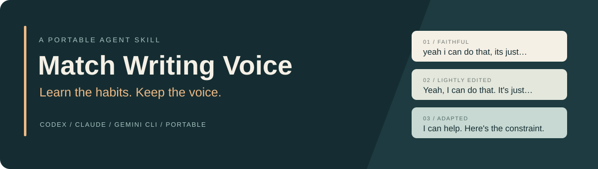
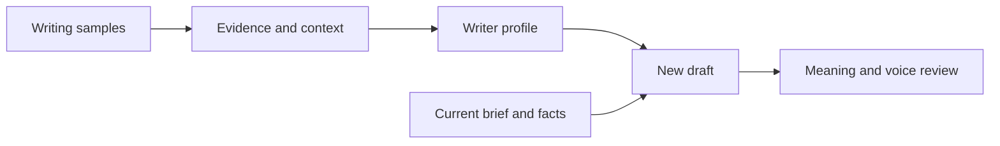

<p align="center"></p>

<p align="center">
  <strong>Evidence-backed writing voices for Codex, Claude, Gemini CLI, and other assistants.</strong><br>
  One portable skill. Separate writer profiles. Three editing modes.
</p>

<p align="center">
  <a href="docs/installation.md">Install</a> ·
  <a href="docs/usage.md">Use it</a> ·
  <a href="examples/README.md">See an example</a> ·
  <a href="docs/compatibility.md">Compatibility</a> ·
  <a href="docs/design-research.md">Design research</a>
</p>

# Match Writing Voice

Turn real writing samples into a reusable voice profile, then use that profile to express new ideas. Preserve supported vernacular, rhythm, and recurring imperfections—or lightly edit them when asked.

The skill also distinguishes the writer's likely familiarity from the assistant's research. It can make qualified inferences about familiarity without inventing expertise, personal experience, or a claim that the writer just learned something.

**Rewrite mode** transforms an existing paragraph, essay, or document into the target voice. Choose minimal edits, a standard rewrite, or paragraph-level restructuring. Protect exact citations, equations, and technical terms when comparing versions. [Rewrite controls and examples →](docs/usage.md#rewrite-existing-content)

**Humanizer review** is a default priority for drafts and rewrites. It fixes stock openings, empty recaps, and formulaic phrasing where they weaken the prose, using the learned voice to shape the repair. You can also request an audit on its own. [How review works →](docs/usage.md#review-generic-phrasing-without-erasing-the-voice)

The review also incorporates selected ideas from Humanizer, De-Slop, and related skills: paragraph purpose, missing-content triage, reader context, local keep decisions, and protection against an editor-imposed voice. Optional read-only text inspection locates unusual codepoints without changing the source. [Comparison and provenance →](docs/editorial-research.md)

**Revision comparison and history** show exact edits, before/after measurements, applicable voice evidence, and separate editorial reasons. Save original and revised snapshots only when requested. A separate offline evaluator summarizes actual supplied detector results with text hashes and declared origins. [Compare and track edits →](docs/usage.md#compare-revisions-and-track-edits)

## Start here

Prefer choices? After installation, ask **“Use Match Writing Voice in guided mode”** to pick a profile, task, editing mode, and context. Known settings are skipped; ordinary direct prompts still work. The host supplies question cards when available, with a text-menu fallback. [Guided picker and local profile catalog →](docs/usage.md#optional-guided-picker)

Clone this private repository with an authenticated GitHub account:

```sh
gh repo clone danielcarde/match-writing-voice
cd match-writing-voice
```

Choose one installation route per assistant. For a local, dependency-free install:

```sh
python tools/install.py --agent codex --scope user
# Or: --agent claude-code / --agent gemini-cli
```

For Claude web/desktop, download `match-writing-voice-claude.zip` from [Releases](https://github.com/danielcarde/match-writing-voice/releases), upload it through **Customize → Skills**, and enable it. For a chat without native skills, attach `match-writing-voice-portable.md` instead. [Complete setup instructions →](docs/installation.md)

Then supply your samples and ask:

```text
Use Match Writing Voice. These are my writing samples.
Build a profile of my voice, including recurring grammar and punctuation habits.
Then draft a message asking to reschedule an appointment. Use faithful mode.
```

In Codex, explicitly mention `$match-writing-voice`. In a standalone Claude Code installation, use `/match-writing-voice`. Gemini CLI activates matching skills after its normal consent prompt.

## What it preserves

| Layer | Examples |
|---|---|
| Words | Vernacular, contractions, idioms, favored expressions, code-switching |
| Sentences | Fragments, coordination, interruptions, rhythm, length variation |
| Surface habits | Casing, punctuation, recurring spelling and grammar irregularities |
| Passages | Paragraph shape, openings, closings, explanation order, rhetorical habits |
| Context | Medium, audience, relationship, language, degree of formality |
| Evidence | Source spans, independent samples, counterexamples, uncertainty |

An isolated typo is weak evidence. A repeated habit still belongs in its context. The skill does not add random errors or force a favorite expression into every paragraph.

## Choose the amount of editing

| Mode | Result |
|---|---|
| **Faithful** | Preserves supported imperfections at a natural frequency. Default. |
| **Lightly edited** | Keeps the voice while correcting clear slips, with protected preferences retained. |
| **Adapted** | Carries stable traits into another medium or audience. |

Synthetic demonstration, using the same requested facts:

> **Faithful:** yeah i can bring the projector to the library on tuesday, its just that i need it back by 5 pm.
>
> **Lightly edited:** Yeah, I can bring the projector to the library on Tuesday. It's just that I need it back by 5 pm.

These examples demonstrate mode choices; they are not a real writer's recognition score. [Explore the reproducible example →](examples/README.md)

## Rewrite a paragraph, essay, or document

```text
Use Match Writing Voice in rewrite mode.
Rewrite this document in the voice of my attached profile.
Keep the original structure, facts, arguments, examples, quotes, and citations.
Use faithful editing and return the complete rewritten document.
```

Structure is preserved by default. You can request restructuring, select only a passage, or choose lightly edited/adapted output. The source provides content; the profile provides voice. [Full rewrite workflow →](skills/match-writing-voice/references/rewrite.md)

## How it works



The skill supplies a method. A writer profile supplies individual habits. Optional Python tools measure text, verify evidence, retrieve context-matched examples, and flag narrow draft problems. Learning uses the host model's interpretation; measurements alone are an unfinished profile.

No separate API key, database, paid service, or third-party Python package is required by the bundled tools. Image/document extraction depends on the host. Files read by a model remain subject to that provider's data handling.

## Compatibility

| Environment | Route | Validation |
|---|---|---|
| Codex | Native skill; optional plugin wrapper | Tool tests and synthetic application exercise |
| Claude Code | Native skill or plugin marketplace | Package/metadata checks; host session not exercised |
| Claude web/desktop | Custom-skill ZIP | Upload format checked; live upload not exercised |
| Gemini CLI | Native Agent Skill | Official format/path checks; host session not exercised |
| Other chat assistants | Self-contained Markdown guide | Manual workflow; execution depends on host tools |

**Gemini CLI and the Gemini chat app are different products.** This repo documents native Gemini CLI installation; use the portable guide for other chat surfaces. Format compatibility does not guarantee identical model behavior. [Details and official sources →](docs/compatibility.md)

## Develop and verify

Python **3.10+** is needed only for local helpers and checks.

```sh
python -m unittest discover -s tests -p "test_*.py" -v
python tools/build.py --check
python tools/build.py
python tools/demo.py
```

Builds produce native/Claude ZIPs, a Gemini-compatible `.skill` archive, a standalone guide, and SHA-256 checksums in `dist/`. CI runs on Linux, Windows, and macOS. Automated checks cover mechanics; real author evaluation remains a separate process.

## Repository map

```text
skills/match-writing-voice/  Canonical skill, references, and runtime helpers
tools/                      Build, install, and synthetic-demo tools
tests/                      Repository and skill checks
examples/                   Synthetic source samples and a documented brief
docs/                       Installation, usage, compatibility, and design research
.github/                    CI, dependency updates, and contribution templates
```

The repo deliberately keeps personal corpora and learned profiles out of source control. Use `.local/` for local experiments. [Privacy and behavior boundaries →](docs/privacy.md)

## Contribute and acknowledge

See [CONTRIBUTING.md](CONTRIBUTING.md) for tests, scope, and review expectations. [NOTICE.md](NOTICE.md) credits conceptual influences and links the source research. This is an original implementation, not a combined copy of upstream repositories.

## License

This is a private repository. No open-source license has been selected. Upstream projects retain their own terms; conceptual attribution does not relicense their implementations.
